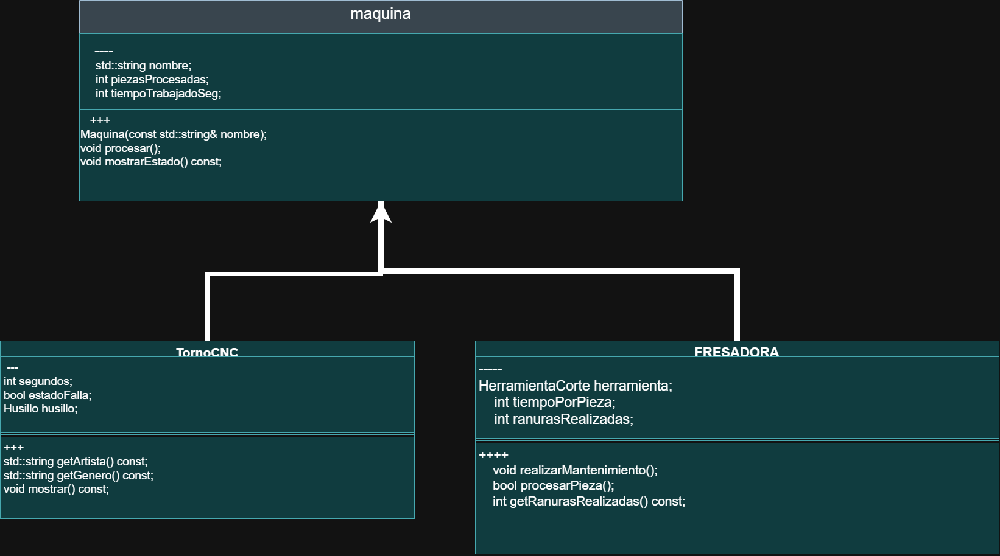
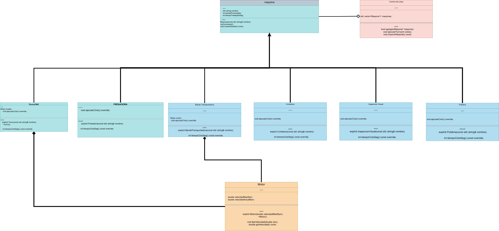

# Práctica Unidad IV: La evolución de una máquina

Programación Orientada a Objetos · Ingeniería Mecatrónica · Tercer semestre

Llena cada espacio conforme avances en las fases de [PRACTICA.md](PRACTICA.md).

## Fase 1. Entender el problema

**1.1 El problema con mis propias palabras**

la primera implementacion de maquina se escribio de manera rapida, no tiene reglas y espera a que alguien cometa algun error

**1.2 Reglas que siempre deben cumplirse en una máquina** (escribe al menos tres)

1. el numero de piezas nunca debe ser negativo
2. siempre completara su trabajo al menos que necesite mantenimiento
3. la maquina noo puede operar si esta en falla

**1.3 ¿Quién más usa la clase `Maquina`? ¿Qué podría salir mal si otro equipo crea una máquina nueva sin conocer tus reglas?**

torno, fresadora, etc

el codigo podria no funcionar o la maquina no presentaria el comportamiento debido

## Fase 2. Diseñar la solución

**2.1 Diagrama inicial (Etapa 0)**

**2.2 Diagrama final (Etapa 9)**

**2.3 ¿Qué cambió entre los dos diagramas?**

| Elemento | Etapa 0 | Etapa 9 | Etapa que lo cambió |
| --- | --- | --- | --- |
| Visibilidad de los atributos de `Maquina` | public | private, protected, public | etapa 1 |
| `procesar()` | void procesar(); | virtual void procesar()... | etapa 2 |
| `tiempoCicloSeg()` | int tiempoCicloSeg() | virtual int tiempoCicloSeg()... | etapa 2 |
| Destructor de `Maquina` | no existia | virtual ~Maquina() = default | etapa 4 |
| ¿Se pueden crear objetos `Maquina`? | antes se creaban maquinas que no existian | virtual void procesar() = 0;
    virtual int tiempoCicloSeg() const = 0; | etapa 5 |
| Relación `ControlDeLinea` - `Maquina` | no existia control de linea | composicion agregacion | etapa 3 |
| Relación `Torno` - `Motor` | no existia motor | relacion composicion | etapa 4 |
| Relación `BandaTransportadora` - `Motor` | no existia motor | relacion composicion | etapa 8  |

## Fase 3. Implementar

**3.0 Etapa 0. Una máquina sin reglas**

a) ¿Qué imprime `ejecutarTurno()` para el torno y la fresadora? ¿Por qué no imprime "torneando" ni "fresando"?

Torno T-01: procesamiento generico
Torno T-01: procesamiento generico
Fresadora F-01: procesamiento generico
Fresadora F-01: procesamiento generico

por que esta utilizando la funcion del archivo base (maquina)

b) ¿Por qué el torno acumula 65 s y no 135 s?

por que primero agrega el teimpo de su respectivo .cpp pero luego agrega el tiempo definido en maquina.cpp

**3.1 Etapa 1. Invariantes y constructores explicit**

a) ¿Qué regla de la sección 1.2 rompió `torno.piezasProcesadas = -5;`?

el numero de piezas nunca debe ser negativo

b) ¿De dónde salió la máquina "Fantasma"? ¿Qué hizo el compilador sin que se lo pidieras?

de un std::string el compilador, lo asigno como una maquina clase vacia
c) ¿Qué tuviste que cambiar en `Torno` y `Fresadora` y por qué?

agregar los gets en cada maquina para que asi pudieran acceder a los valores primados

**3.2 Etapa 2. Virtual y override**

a) La fresadora acumula 180 s, pero reporta 360 pzas/h. ¿Por qué un cálculo usó 60 s y el otro 10 s?

por que en uno esta utilizando los valores y munciones de la clase base maquina

b) ¿Tu compilador mostró alguna advertencia antes de usar `override`? ¿Qué mensaje dio después de agregar `override`?

No mostro ninguna advertencia,  Torno T-01 | piezas: 3 | tiempo: 135 | capacidad: 80 pzas/h s
Fresadora F-01 | piezas: 3 | tiempo: 180 | capacidad: 60 pzas/h s

**3.3 Etapa 3. La línea de producción**

a) ¿Por qué la línea procesó todo como "generico" si `procesar()` ya es virtual?

por que sigue usando la version declarada en la clase base

b) ¿Por qué el torno y la fresadora originales quedaron con 0 piezas?

no esta guardando una version anterior de loas maquinas, sino muestra las plantillas vacias

c) La relación entre `ControlDeLinea` y `Maquina`, ¿es composición o agregación? ¿Por qué?

agregacion, por que la linea de control es independiente a la maquina

**3.4 Etapa 4. Destructores**

| Momento | Mensajes de destrucción que aparecieron |
| --- | --- |
| `delete temporal;` sin destructor virtual | Destruyendo Maquina|
| `delete temporal;` con destructor virtual |   Destruyendo Torno
destruyendo Motor
Destryuendo Maquina |
| Al terminar `main` (torno y fresadora) |   Destruyendo Torno
destruyendo Motor
Destryuendo Maquina |

a) ¿Qué advertencia mostró el compilador? ¿Por qué decimos que ya te estaba avisando del problema?

src/main.cpp: In function 'int main()':
src/main.cpp:20:5: warning: deleting object of polymorphic class type 'Maquina' which has non-virtual destructor might cause undefined behavior [-Wdelete-non-virtual-dtor]
   20 |     delete temporal;
      |     ^~~~~~~~~~~~~~~

      por que es el compilador mismo que te dice en donde se encuentra el problema

b) ¿Por qué el torno de `main` sí se destruyó completo aunque el destructor no fuera virtual? ¿A qué máquina corresponde el primer "Destruyendo Maquina" después de "Fin de main"?

al terminar se llaman sus propios destructores

**3.5 Etapa 5. La clase abstracta**

a) Copia los mensajes de error y explica con tus palabras qué dice cada uno.

src/main.cpp:10:14: error: cannot declare variable 'pulidora' to be of abstract type 'Pulidora'
include/Pulidora.h:6:7: note:   because the following virtual functions are pure within 'Pulidora':
include/Maquina.h:21:18: note:     'virtual void Maquina::procesar()'
no se puede declarar pulidora del tipo Pulidora por que contiene funciones virtuales no declaradas

src/main.cpp:11:13: error: cannot declare variable 'generica' to be of abstract type 'Maquina'
include/Maquina.h:6:7: note:   because the following virtual functions are pure within 'Maquina':
include/Maquina.h:21:18: note:     'virtual void Maquina::procesar()'
include/Maquina.h:22:17: note:     'virtual int Maquina::tiempoCicloSeg() const'
no se puede declarar generica del tipo maquina gracias a que las funciones virtuales contienen  = 0 ademas que no se les da un "como"

b) ¿Por qué es mejor este error de compilación que el comportamiento "generico" de antes?

no permite que el programa realize el proceso de forma incorrecta o sin tener todo lo necesario

**3.6 Etapa 6. El contrato que el compilador no ve**

a) ¿Qué partes del contrato violó `InspeccionVisual`?

contrato de proccesar, su funcion solo llama a que devuelva su nombre, no las piezas procesadas ni los segundos

b) ¿Por qué el compilador no lo detectó?

tecnicamente todo esta en orden, utiliza la funcion por defecto establecida en maquina

c) ¿Qué pasaría si el próximo equipo tampoco lee el comentario del contrato?

se llegarian a romper las reglas que siempre deben cumplirse

**3.7 Etapa 7. La base hace cumplir el contrato**

a) ¿Cómo puede una clase derivada sobrescribir un método que es privado en la base?

con la funcion override

b) ¿Qué ocurre ahora con una máquina cuyo tiempo de ciclo es 0? Compáralo con la Etapa 6.

 Error: Inspeccion I-01: tiempoCicloSeg() debe ser mayor que cero

c) ¿Por qué la línea ignoró el "atajo" del torno, pero la llamada directa no? ¿Cómo corregiste el diseño?

por que en procesar utiliza el ejecutar ciclo declarado en maquina, sin sobre escribir su la forma en que lo hace, la llamada directa utiliza el override, para que la llamada se realize de foma correcta se necesita usar override

**3.8 Etapa 8. Herencia mal usada**

a) Da al menos dos razones por las que `BandaTransportadora : public Motor` es un error de diseño.

1.-por como esta, la banda transportadora NO es un motor, es un tipo de maquina
2.-La banda deberia contener un motor

b) La relación entre `BandaTransportadora` y `Motor`, ¿es composición o agregación? ¿Por qué?

composicion

**3.9 Etapa 9. La librería y la prueba final**

a) Después de agregar la `Cortadora`, ¿qué archivos mostró `git status`? ¿Cuántos archivos de la librería tuviste que modificar?
modified:   main.cpp new file:   cortadora.h new file:   cortadora.cpp modifique 1

b) ¿Qué pasó al escribir `-lplanta` antes de `src/main.cpp`? ¿Por qué?

se lee primero la libreria, primero debe saber como hacer las cosas antes

**3.10 Bitácora de dudas**

| # | Etapa | Duda | Cómo la resolví | Fuente |
| --- | --- | --- | --- | --- |
| 1 | _____ | _____ | _____ | _____ |
| 2 | _____ | _____ | _____ | _____ |
| 3 | _____ | _____ | _____ | _____ |

## Fase 4. Probar y mejorar

**4.1 Tabla de pruebas**

| # | Caso | Resultado esperado | Resultado obtenido | ¿Pasa? |
| --- | --- | --- | --- | --- |
| 1 | Máquina con nombre vacío | Excepción con mensaje claro | Error: nombre vacio | lanza el error |
| 2 | Reporte de una línea vacía | "La linea no tiene maquinas" | La linea no tiene maquinas | se muestra el mensaje y no sucede nada mas |
| 3 | `agregar(nullptr)` | Devuelve `false` | devuelve false| la linea estara vacia |
| 4 | Reporte antes de ejecutar el turno | 0 piezas, 0 s y capacidad calculada | Torno T-01 | piezas: 0 | tiempo: 0 | capacidad: 80 pzas/h s | no se le suma el tiempo o numero de piezas |
| 5 | Turno de 0 ciclos | Nada cambia | Fresadora F-01 | piezas: 0 | tiempo: 0 | capacidad: 60 pzas/h s| no se realiza ningun cambio |
| 6 | Torno con 3 ciclos | 3 piezas, 135 s, 80 pzas/h | Torno T-01 | piezas: 3 | tiempo: 135 | capacidad: 80 pzas/h s | se realizan bien los calculos |
| 7 | Máquina con `tiempoCicloSeg()` igual a 0 | Excepción con mensaje claro | Error: Torno T-01: tiempoCicloSeg() debe ser mayor que cero | aparece el mensaje de error |
| 8 | Máquina con `tiempoCicloSeg()` negativo | Excepción con mensaje claro | Error: Torno T-01: tiempoCicloSeg() debe ser mayor que cero | no acepta numeros negativos |
| 9 | La misma máquina agregada dos veces | solo aparece una vez| Torno T-01 | piezas: 1 | tiempo: 45 | capacidad: 80 pzas/h s
Fresadora F-01 | piezas: 1 | tiempo: 60 | capacidad: 60 pzas/h s | solo se reporta una vez |

**4.2 Bitácora de mejoras**

| # | Falla o mejora detectada | Qué cambié | Por qué |
| --- | --- | --- | --- |
| 1 |se podia agregar la misma maquina mas de una vez| modifique la funcion agregar para que revise si se agrego la misma maquina dos veces | solo se debe registrar cada maquina una sola vez |
| 2 | _____ | _____ | _____ |

Retos opcionales que intenté: _____

## Fase 5. Publicar en GitHub

**5.1 Enlace a mi fork**

https://github.com/mowhackcat/ulsa_ime_3_poo_evolucion_maquina

## Cierre y reflexión

**6.1 Errores que ya no pueden ocurrir**

| Error | Etapa en que apareció | Restricción que lo impide ahora | ¿Quién lo detecta: el compilador o el programa? |
| --- | --- | --- | --- |
| Contadores con valores inválidos | etapa 1 | piezasProcesadas(0) | programa |
| Máquina "fantasma" creada a escondidas | etapa 1 | proteger los estados de la maquina| programa |
| Método que no sobrescribe por un `const` | etapa 2 | utilizar override | programa |
| Máquinas copiadas y "rebanadas" | etapa 3 | utilizar virtual | programa |
| Destrucción incompleta | etapa 4 | usar un destructor virtual | programa |
| Máquina sin `procesar()` propio | etapa 5 | el que tenga su propio "procesar" | compilador |
| Tiempo de ciclo inválido | etapa 1 | serie de condiciones para asegurar que sea valido | compilador |
| Derivada que no registra sus piezas | etapa 7 | evitar usar atajos y asegurar que se llame la funcion que llame a registrar las piezas | programa |

**6.2 ¿Cuál de los errores fue el más peligroso: el de compilación, la advertencia o el que compilaba sin problemas? ¿Por qué?**

el que compilaba sin problemas, por que nos hace pensar que el codigo esta bien escrito

**6.3 ¿Qué aprendiste en esta práctica?**

utilizar funciones virtuales, lor errores y usar override

**6.4 ¿Qué cambiarías de tu proceso la próxima vez?**

comenzar con virtual desde un inicio
